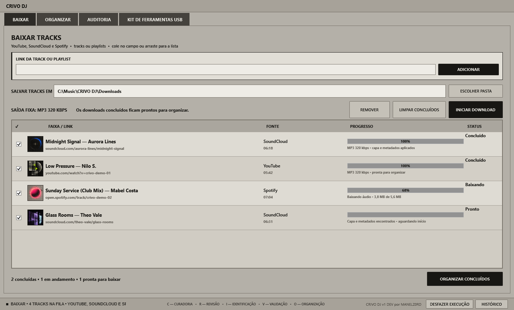
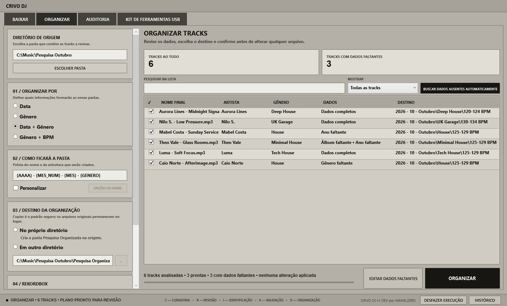
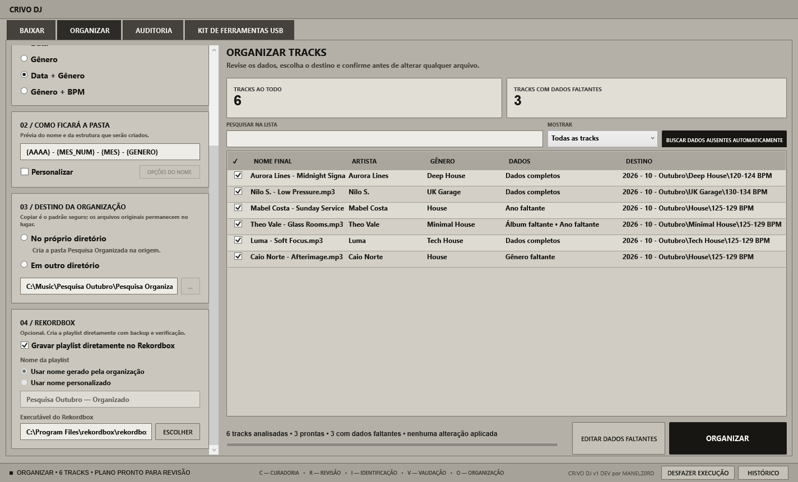
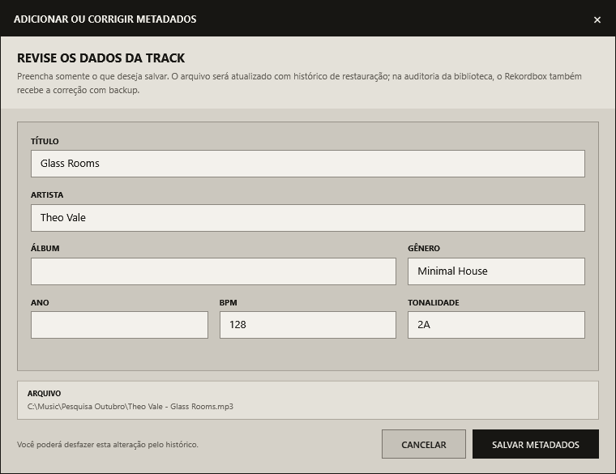
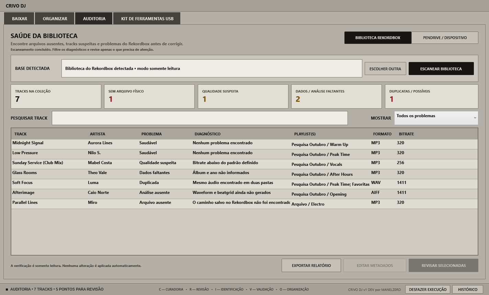
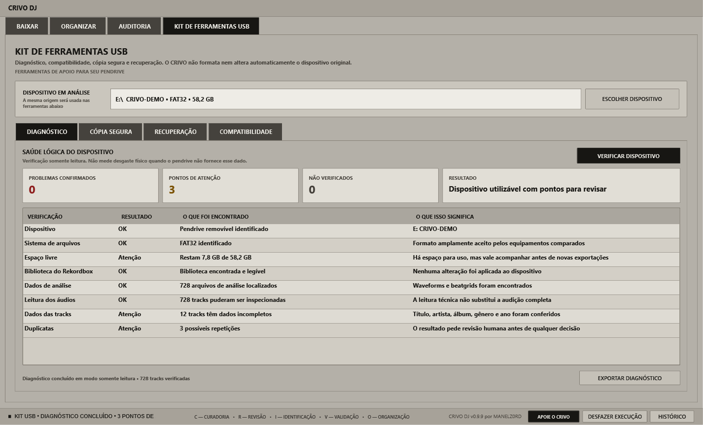
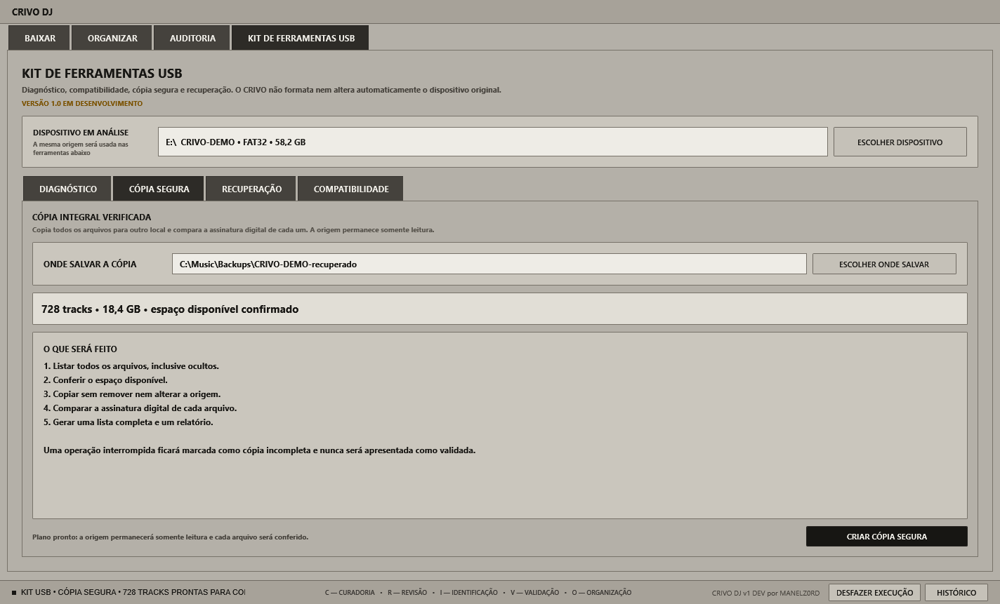
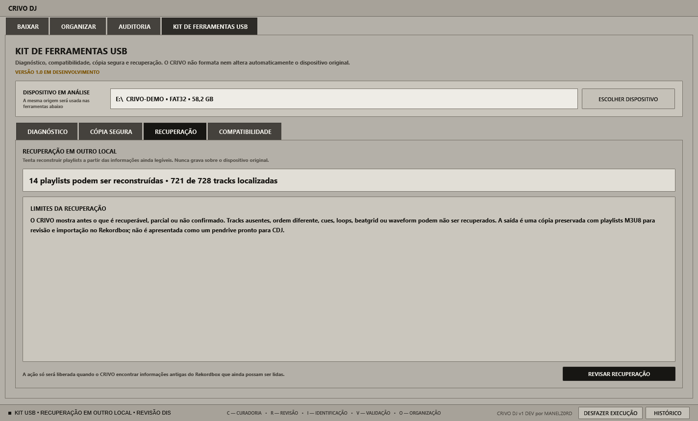
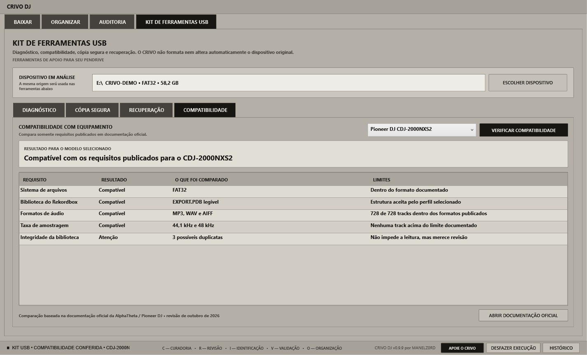

  

<h1 align="center">CRIVO DJ</h1>

<strong>Da pesquisa ao Rekordbox, com auditoria e ferramentas USB.</strong>

  
  
  
  
  

<strong>CRIVO DJ por MANELZ0RD</strong>

O CRIVO DJ concentra o fluxo de pesquisa musical em um aplicativo portátil para Windows. Ele baixa tracks ou playlists, organiza os arquivos, ajuda a completar dados ausentes e pode criar a playlist diretamente no Rekordbox. A auditoria e o Kit de Ferramentas USB funcionam como áreas independentes para conferir bibliotecas e cuidar de pendrives de DJ.

> A versão para macOS está em desenvolvimento. A versão completa disponível nesta página é a de Windows.

## Download para Windows

[**Baixar CRIVO DJ v0.9.9 para Windows**](https://github.com/manelz0rd2/CRIVO-DJ/releases/download/v0.9.9/CRIVO-DJ-v0.9.9-Windows-Kit-USB.zip)

Extraia o ZIP inteiro e abra `CRIVO DJ.exe`. O aplicativo não possui instalador e não exige privilégios de administrador para o uso comum. Não execute o programa de dentro do ZIP, pois as ferramentas incluídas precisam permanecer juntas na pasta extraída.

O repositório guarda o código-fonte, testes e documentação. O pacote pronto para uso fica anexado à [Release v0.9.9](https://github.com/manelz0rd2/CRIVO-DJ/releases/tag/v0.9.9).

## Do download da música ao Rekordbox

Cole ou arraste o link de uma track ou playlist do YouTube, SoundCloud ou Spotify. Playlists são separadas em tracks na lista, com capa, título, artista, duração, progresso e resultado individual. Nada é baixado antes da confirmação.

No Spotify, o CRIVO usa os dados da música para procurar uma fonte externa compatível; ele não extrai o áudio do streaming. A disponibilidade e a qualidade dependem da fonte encontrada. Baixe somente conteúdos que você tenha autorização para usar.

## Organizar músicas

O download não é obrigatório. Você pode escolher a pasta das músicas baixadas pelo CRIVO ou qualquer pasta que já contenha sua pesquisa musical.

Na etapa de organização, você escolhe:

1. o diretório de origem;
2. como as músicas serão agrupadas;
3. como ficará o nome e a estrutura das pastas;
4. o destino da organização;
5. se deseja criar a playlist diretamente no Rekordbox.

A lista mostra o nome final, artista, gênero, dados faltantes e destino de cada track antes de qualquer mudança. O modo seguro copia os arquivos e preserva os originais.

### Revisar dados da track

Quando uma música possui título, artista, álbum, gênero, ano ou outro dado ausente, você pode revisar e corrigir as informações manualmente. A busca automática apresenta sugestões quando encontra resultados, mas a decisão final continua com o usuário.

Se a gravação no Rekordbox estiver marcada, o CRIVO exige que o Rekordbox esteja fechado, cria um backup do banco, grava somente a playlist solicitada e verifica o resultado. O Rekordbox continua responsável pela análise de waveform, beatgrid, BPM e tonalidade.

## Auditoria da biblioteca

A Auditoria lê a biblioteca do Rekordbox ou um pendrive exportado em modo somente leitura. Ela reúne em uma lista as tracks saudáveis e os pontos que precisam de atenção, incluindo arquivo ausente, qualidade suspeita, dados ou análise faltantes e duplicatas possíveis.

As colunas mostram o problema, o diagnóstico, as playlists em que a track aparece, formato e bitrate. Os resultados podem ser pesquisados, filtrados e exportados. O escaneamento não corrige nada automaticamente.

## Kit de Ferramentas USB

O Kit USB reúne quatro etapas complementares. Cada uma informa claramente o que será apenas lido e o que pode gerar novos arquivos.

### Diagnóstico

Verifica se o dispositivo foi reconhecido, o sistema de arquivos, o espaço livre, a estrutura da biblioteca, dados de análise, leitura dos áudios, qualidade, dados faltantes e duplicatas. O diagnóstico não altera o pendrive.

### Cópia segura

Cria uma cópia dos arquivos e da estrutura encontrada em outro local antes de qualquer tentativa de recuperação. A origem permanece intacta.

### Recuperação

Monta uma cópia recuperada em outro diretório a partir do que ainda pode ser lido. O CRIVO apresenta um plano antes de começar e deixa claro que arquivos danificados ou ausentes podem não ser recuperados.

### Compatibilidade

Compara a estrutura e o formato do pendrive com o equipamento escolhido. O resultado é uma orientação baseada nos requisitos conhecidos; a confirmação final continua sendo o teste no equipamento real.

## Segurança e limites

- simulações e diagnósticos não alteram arquivos;
- copiar é o comportamento padrão da organização;
- gravações no Rekordbox usam backup, transação e verificação;
- recuperação de pendrive sempre cria o resultado em outro local;
- possíveis duplicatas exigem revisão humana;
- serviços externos podem mudar, bloquear links ou deixar uma música indisponível;
- mantenha backup da biblioteca e teste pendrives no equipamento antes de uma apresentação.

## Projeto e colaboração

Consulte o [histórico de versões](CHANGELOG.md), as [orientações para contribuir](CONTRIBUTING.md), a [política de segurança](SECURITY.md) e as [dependências de terceiros](THIRD-PARTY.md).

Este repositório ainda não possui uma licença pública de reutilização. Todos os direitos permanecem reservados a MANELZ0RD até a definição da licença do projeto. As dependências mantêm suas próprias licenças.

## Recursos

- baixa tracks individuais ou playlists do YouTube, SoundCloud e Spotify;
- separa playlists em tracks e acompanha cada item individualmente;
- mantém a capa e os dados próprios de cada track quando a fonte os fornece;
- organiza músicas baixadas ou pastas que o usuário já possui;
- permite nomes livres e estruturas de pasta por data, gênero, BPM e outros dados;
- identifica dados faltantes e permite revisão manual ou busca de sugestões;
- copia as músicas organizadas e pode criar a playlist diretamente no Rekordbox;
- audita bibliotecas do Rekordbox e pendrives exportados;
- mostra problema, diagnóstico, playlists, formato e qualidade de cada track;
- detecta arquivos ausentes, análises faltantes e duplicatas exatas ou possíveis;
- diagnostica pendrives, cria cópia segura e prepara uma recuperação em outro local;
- compara o pendrive com equipamentos compatíveis selecionados;
- exporta relatórios e mantém histórico das operações compatíveis;
- funciona de forma portátil no Windows, sem instalação.

## Recursos técnicos

- interface WPF executada no Windows PowerShell 5.1, com launcher próprio em C#;
- leitura e gravação de tags por TagLibSharp nos formatos compatíveis;
- fila de download baseada em yt-dlp, FFmpeg e spotDL, com expansão de playlists e resolução assíncrona de dados;
- enriquecimento por MusicBrainz e identificação opcional por fingerprint AcoustID;
- organização com plano prévio, modelos de destino, tratamento de conflitos e histórico reversível;
- detecção de duplicatas por nome, tamanho, metadados semelhantes e SHA-256;
- inspeção de codec, bitrate, sample rate e bit depth;
- integração com o `master.db` do Rekordbox por Pyrekordbox e SQLCipher, protegida por backup, transação e validação;
- leitura de playlists, pastas de playlists e arquivos de análise do Rekordbox;
- análise somente leitura de dispositivos, reconstrução em diretório separado e comparação de compatibilidade;
- relatórios CSV e JSON, logs sanitizados e modo de diagnóstico;
- testes automatizados de regressão, interface, stress, auditoria em runtime e escrita em banco sandbox.
